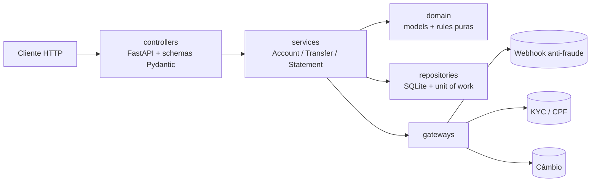
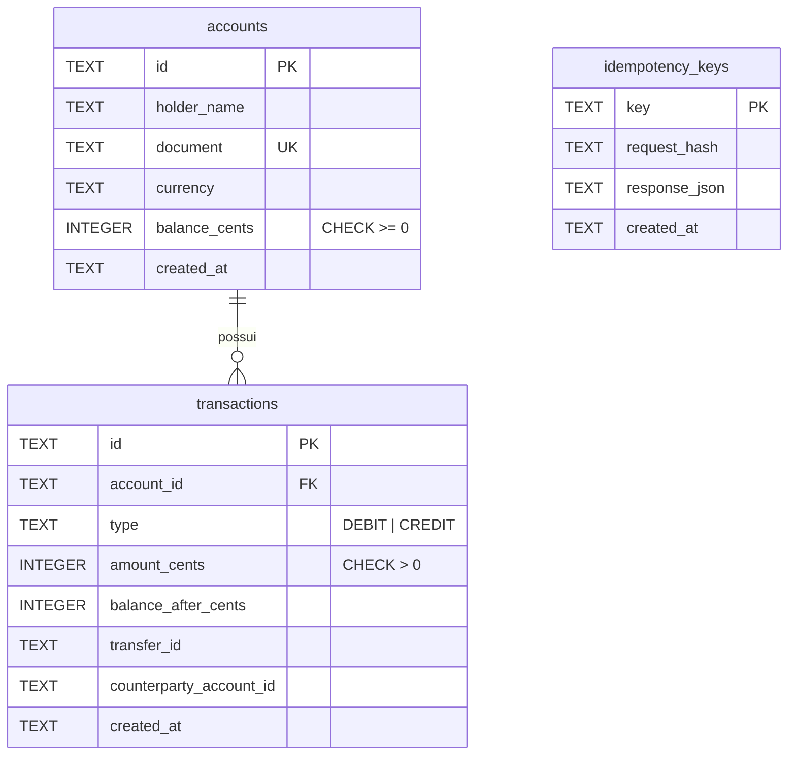

# Relatório Técnico — Wallet API (projeto-self-testing-ci)

> Projeto Capstone: API de microsserviço financeiro com automação de CI, suíte de
> self-testing multinível e estratégia de branching.

## Links

| Item | Link |
|------|------|
| Repositório | `https://github.com/<usuario>/projeto-self-testing-ci` *(substituir após o push)* |
| Execuções do pipeline | `https://github.com/<usuario>/projeto-self-testing-ci/actions` |
| Pipeline | [`.github/workflows/ci.yml`](.github/workflows/ci.yml) |
| Script de carga | [`load/locustfile.py`](load/locustfile.py) |
| Evidência de carga | [`docs/evidencias/load-test-summary.json`](docs/evidencias/load-test-summary.json) |

---

## 1. Visão geral e escopo

A Wallet API é um microsserviço REST de carteira digital e conciliação bancária. Ela oferece:

1. criação e consulta de contas digitais com saldo inicial;
2. transferência entre contas com controle de concorrência, saldo insuficiente e idempotência;
3. extrato com filtros por período e por tipo de transação (débito/crédito);
4. integração com um gateway anti-fraude externo fictício, que recebe um webhook a cada transferência.

**Stack:** Python 3.13, FastAPI, SQLite (arquivo em produção, `:memory:` nos testes), PyTest,
pytest-cov (Coverage.py), Ruff, Locust e GitHub Actions.

## 2. Especificação de Requisitos de Software (SRS)

### 2.1 Atores

| Ator | Descrição |
|------|-----------|
| Cliente da API | Sistema consumidor (app, internet banking) que opera contas e transferências. |
| Gateway anti-fraude | Serviço externo que recebe eventos de transferência via webhook. |
| Provedor cadastral (KYC) | Valida os dados do titular (nome e CPF). |
| Provedor de câmbio | Fornece a taxa de conversão entre moedas. |

### 2.2 Requisitos funcionais

| ID | Requisito | Critério de aceitação |
|----|-----------|-----------------------|
| RF01 | Criar uma conta com titular, CPF, moeda (BRL/USD/EUR) e saldo inicial ≥ 0. | `POST /accounts` retorna 201. Se o saldo inicial for maior que zero, gera um lançamento de crédito "Saldo inicial". |
| RF02 | Validar o cadastro (KYC) antes de criar a conta. | CPF inválido ou nome com menos de 3 caracteres → 422 `invalid_holder`. |
| RF03 | Impedir duas contas com o mesmo CPF. | 409 `duplicate_account`. |
| RF04 | Consultar uma conta e o seu saldo. | `GET /accounts/{id}` → 200, ou 404 se a conta não existir. |
| RF05 | Transferir valores entre contas de forma atômica. | Débito e crédito são gravados na mesma transação. Se algo falhar, nada é gravado. |
| RF06 | Recusar uma transferência sem saldo suficiente. | 422 `insufficient_funds`. Os saldos não mudam e o anti-fraude não é notificado. |
| RF07 | Garantir idempotência pelo header `Idempotency-Key`. | Repetir a mesma chave com o mesmo payload → 200 com o mesmo resultado e sem novo débito. Mesma chave com payload diferente → 409 `idempotency_conflict`. |
| RF08 | Converter o valor quando as moedas das contas forem diferentes. | O crédito é igual ao débito × taxa, com arredondamento bancário (HALF_EVEN). |
| RF09 | Emitir o extrato com filtros `start_date`, `end_date` (inclusivos) e `type`. | Lista ordenada por data, com totais de crédito, débito e líquido. Período invertido → 422. |
| RF10 | Notificar o gateway anti-fraude a cada transferência efetivada. | Webhook `transfer.completed` com conta de origem, conta de destino, valor, moeda e `high_risk` (valor ≥ limiar configurável). |

### 2.3 Requisitos não funcionais

| ID | Categoria | Requisito |
|----|-----------|-----------|
| RNF01 | Consistência | Nenhuma condição de corrida pode gerar saldo negativo nem criar ou destruir dinheiro. A soma dos saldos se conserva sob concorrência. |
| RNF02 | Desempenho | Com 50 requisições simultâneas em `POST /transfers`: taxa de erro igual a 0% e latência média abaixo de 200 ms em ambiente de CI. |
| RNF03 | Resiliência | Uma falha do gateway anti-fraude não desfaz uma transferência já confirmada. A falha é registrada em log (WARNING). |
| RNF04 | Precisão monetária | Valores sempre em centavos inteiros e conversões com `Decimal`, sem uso de `float`. |
| RNF05 | Qualidade | Cobertura mínima de 85% das linhas e de 80% dos branches, verificada automaticamente no CI. |
| RNF06 | Manutenibilidade | Lint e formatação com Ruff e complexidade ciclomática de no máximo 10 por função. |
| RNF07 | Configurabilidade | Toda a configuração vem de variáveis de ambiente (`.env.example`), sem segredos no código. |
| RNF08 | Rastreabilidade | Commits seguem Conventional Commits. `main` e `develop` só recebem código por merge validado. |

### 2.4 Regras de negócio

* **RN01:** o valor de uma transferência deve ser um inteiro entre 1 e 100.000.000 centavos (R$ 1 milhão).
* **RN02:** a conta de origem deve ser diferente da conta de destino.
* **RN03:** uma conversão que arredonda para zero centavos é rejeitada.
* **RN04:** a `Idempotency-Key` deve ter de 1 a 128 caracteres e é registrada **na mesma transação** da transferência.
* **RN05:** o banco de dados também protege os saldos: `CHECK (balance_cents >= 0)`.

### 2.5 Rastreabilidade entre requisitos e testes

| Requisito | Testes |
|-----------|--------|
| RF01–RF04 | `tests/integration/test_account_service.py`, `tests/e2e/test_wallet_flow.py::test_account_errors` |
| RF05, RF06 | `tests/unit/test_transfer_rules.py`, `tests/integration/test_transfer_service.py` |
| RF07 | `test_same_idempotency_key_*`, `test_reusing_idempotency_key_*`, `test_idempotency_conflict_returns_409` |
| RF08 | `tests/unit/test_amount_rules.py::TestConvert`, `test_cross_currency_*` (integração e E2E) |
| RF09 | `tests/integration/test_statement_service.py`, fluxo E2E |
| RF10, RNF03 | `test_antifraud_mock_*`, `test_antifraud_failure_does_not_roll_back_committed_transfer` |
| RNF01 | `test_concurrent_transfers_never_overdraw_and_conserve_money` e o teste de carga (`money_conserved`) |
| RNF05 | `scripts/check_coverage.py` e `tests/unit/test_coverage_gate.py` |

## 3. Arquitetura

### 3.1 Camadas



| Camada | Pasta | Responsabilidade |
|--------|-------|------------------|
| domain | `src/wallet/domain` | Entidades (`Account`, `Transaction`, `TransferResult`), erros e regras **puras**: validação de valor, câmbio, risco, plano de transferência, CPF e resumo do extrato. Não faz I/O. |
| services | `src/wallet/services` | Casos de uso. Orquestram repositório e gateways. O relógio e o gerador de IDs são injetáveis. |
| repositories | `src/wallet/repositories` | Persistência SQLite e unidade de trabalho `atomic()` (lock de processo + `BEGIN IMMEDIATE`). |
| gateways | `src/wallet/gateways` | Portas (`Protocol`) e adaptadores dos serviços externos. |
| controllers | `src/wallet/controllers` | Rotas HTTP, validação de entrada e mapeamento dos erros de domínio para códigos HTTP. |
| container | `src/wallet/container.py` | Composition root. Monta as dependências a partir das configurações e permite trocar adaptadores nos testes. |

### 3.2 Decisões de projeto

1. **Dinheiro em centavos inteiros e `Decimal` com HALF_EVEN.** Elimina os erros de arredondamento de ponto flutuante (RNF04).
2. **Concorrência.** Toda transferência roda dentro de `repo.atomic()`. O `threading.RLock` serializa as threads do worker e o `BEGIN IMMEDIATE` obtém o lock de escrita do SQLite antes da leitura dos saldos. Assim, ler, validar e gravar acontece sem intercalação, o que evita *lost update* e saldo negativo.
3. **Idempotência transacional.** A consulta e o registro da chave acontecem dentro da mesma transação do débito e do crédito. Duas requisições simultâneas com a mesma chave não conseguem debitar duas vezes. O hash do payload (`sha256(origem|destino|valor)`) detecta o reuso indevido de uma chave.
4. **Notificação anti-fraude após o commit.** O webhook só é chamado depois que a transferência é confirmada. Uma falha é registrada em log e não desfaz a operação (RNF03). Uma transferência recusada nunca é notificada.
5. **Portas e adaptadores.** `AntiFraudGateway`, `KycProvider` e `ExchangeRateProvider` são `Protocol`s. Isso permite injetar *mocks* e *stubs* nos testes sem monkeypatch.

### 3.3 Modelo de dados



### 3.4 Contrato HTTP e códigos de erro

| Erro de domínio | HTTP | `error` |
|-----------------|------|---------|
| `AccountNotFoundError` | 404 | `account_not_found` |
| `DuplicateAccountError` | 409 | `duplicate_account` |
| `IdempotencyConflictError` | 409 | `idempotency_conflict` |
| `InsufficientFundsError`, `InvalidAmountError`, `SameAccountTransferError`, `InvalidHolderError`, `UnsupportedCurrencyError`, `InvalidRequestError` | 422 | código específico |

Uma transferência nova responde 201. A repetição idempotente responde 200 com o header `Idempotent-Replayed: true`.

## 4. Estratégia de branching: Git Flow

O repositório segue o **Git Flow**:

| Branch | Uso |
|--------|-----|
| `main` | Somente versões publicadas. Recebe código **apenas por merge** (`--no-ff`) de `release/*` e `hotfix/*`, sempre com tag. |
| `develop` | Integração contínua das features. |
| `feature/*` | Uma por entrega (requisitos, domínio, KYC, repositório, serviços, API, CI, carga e documentação). |
| `release/1.0.0` | Estabilização e troca de versão antes de publicar. |
| `hotfix/1.0.1`, `hotfix/1.0.2` | **Correções emergenciais** a partir de `main`, integradas de volta em `main` e `develop`. |

**Convenção de commits:** Conventional Commits (`feat`, `fix`, `test`, `refactor`, `docs`, `ci`, `chore`, `perf`), com escopo. No TDD, o ciclo aparece no título: `test(...): [RED] ...`, `feat(...): [GREEN] ...`, `refactor(...): [REFACTOR] ...`.

### 4.1 Correções emergenciais documentadas

| Hotfix | Defeito encontrado na v1.0.0 | Correção | Teste de regressão |
|--------|------------------------------|----------|--------------------|
| **v1.0.1** (`hotfix/1.0.1`) | Reusar uma `Idempotency-Key` com **outro valor** devolvia o resultado antigo com status 200. O cliente achava que a nova transferência tinha sido feita, mas ela não acontecia. | Hash do payload gravado com a chave. Divergência → `IdempotencyConflictError` (409). | `test_reusing_idempotency_key_with_different_payload_is_a_conflict`, `test_idempotency_conflict_returns_409` |
| **v1.0.2** (`hotfix/1.0.2`) | O filtro `end_date` do extrato era **exclusivo**: as transações do último dia do período sumiam (ex.: `end_date=2026-11-12` não mostrava uma transação às 23:59 desse dia). | O limite superior passou a ser o início do dia seguinte (`end_date + 1 dia`, exclusivo). | `test_end_date_is_inclusive_until_end_of_day`, `test_single_day_window`, `test_combined_filters` e o E2E com `end_date` |

Cada hotfix tem três commits: teste que reproduz o defeito (`[RED]`), correção (`fix`) e troca de versão. Depois, é integrado em `main` (com tag) e em `develop`.

### 4.2 Proteção de branches (bloqueio de merge)

O script [`scripts/setup_branch_protection.sh`](scripts/setup_branch_protection.sh) configura via API do GitHub, para `main` e `develop`:

* status checks obrigatórios: `Lint e análise estática`, `Testes e coverage gate` e `Teste de carga (50 usuários simultâneos)`, com a branch atualizada (*strict*);
* pull request com pelo menos 1 aprovação, descartando aprovações antigas a cada novo push;
* regras aplicadas também a administradores e proibição de *force push* e de exclusão.

Com isso, um teste quebrado ou uma cobertura abaixo do limite **impede o merge**.

### 4.3 Histórico (grafo)

Saída de `git log --graph --oneline --decorate --all --topo-order` antes do commit deste relatório (release 1.1.0):

```text
*   22a4d0e (HEAD -> feature/relatorio-final, develop) Merge branch 'hotfix/1.0.2' into develop
|\
* \   1813ca3 Merge branch 'hotfix/1.0.1' into develop
|\ \
* \ \   867a695 Merge branch 'release/1.0.0' into develop
|\ \ \
| | | | *   8a3a198 (tag: v1.0.2, main) Merge branch 'hotfix/1.0.2'
| | | | |\
| | | | |/
| | | |/|
| | | * | 4e07c94 chore(release): versão 1.0.2
| | | * | 5c48bf9 fix(statement): torna end_date inclusivo até o fim do dia
| | | * | fe18c91 test(statement): [RED] reproduz exclusão das transações do último dia do período
| | | |/
| | | *   b27154a (tag: v1.0.1) Merge branch 'hotfix/1.0.1'
| | | |\
| | | |/
| | |/|
| | * | 6178dd0 chore(release): versão 1.0.1
| | * | bcbfc2a fix(transfers): retorna 409 quando Idempotency-Key é reutilizada com outro payload
| | * | 30d72a4 test(transfers): [RED] reproduz reuso de Idempotency-Key com payload diferente aceito como replay
| | |/
| | *   09b36b9 (tag: v1.0.0) Merge branch 'release/1.0.0'
| | |\
| | |/
| |/|
| * | dfc3d54 chore(release): versão 1.0.0 e README com instruções de execução
|/ /
* |   eaa883b Merge branch 'feature/teste-carga' into develop
|\ \
| * | 3e0d2f7 (feature/teste-carga) docs(load): registra métricas do teste de carga (taxa de erro e latência)
| * | f454d43 perf(load): teste de carga Locust com 50 usuários simultâneos em POST /transfers
|/ /
* |   01a6147 Merge branch 'feature/pipeline-ci' into develop
|\ \
| * | d076853 (feature/pipeline-ci) chore(ci): script de proteção de branches (status checks + PR revisado)
| * | 36c43ae ci: pipeline GitHub Actions com lint, testes por camada, coverage gate e artefatos
| * | eabd8a4 feat(ci): [GREEN] script de coverage gate (linhas >= 85%, branches >= 80%)
| * | cd95ff9 test(ci): [RED] coverage gate deve auditar linhas e branches separadamente
|/ /
* |   b32d4da Merge branch 'feature/api-rest' into develop
|\ \
| * | dc32535 (feature/api-rest) feat(api): [GREEN] rotas FastAPI, composition root e mapeamento de erros HTTP
| * | f4b61c0 test(api): [RED] fluxo E2E registro → transferência → extrato via HTTP
|/ /
* |   6b58771 Merge branch 'feature/servicos' into develop
|\ \
| * | 69d2b7f (feature/servicos) feat(statement): [GREEN] StatementService com totais de crédito/débito
| * | 39d1e18 test(statement): [RED] extrato com filtros de data e tipo
| * | fa6ce38 feat(transfers): [GREEN] TransferService atômico, idempotente e com notificação pós-commit
| * | 9fceea8 test(transfers): [RED] mock anti-fraude, stub de câmbio, idempotência e 50 threads concorrentes
| * | df6afa0 feat(accounts): [GREEN] AccountService com validação cadastral e lançamento de saldo inicial
| * | 6f0ba7c test(accounts): [RED] abertura de conta com stub de KYC e saldo inicial
|/ /
* |   2c7d859 Merge branch 'feature/gateways-externos' into develop
|\ \
| * | 7e942ff (feature/gateways-externos) feat(gateways): [GREEN] WebhookAntiFraudGateway, StaticExchangeRateProvider e Settings.from_env
| * | 8fa6697 test(gateways): [RED] webhook anti-fraude, câmbio estático e leitura de configuração
|/ /
* |   64461ed Merge branch 'feature/repositorio-sqlite' into develop
|\ \
| * | cdcb9d6 (feature/repositorio-sqlite) feat(repo): [GREEN] repositório SQLite com lock + BEGIN IMMEDIATE e tabela de idempotência
| * | 74f63ca test(repo): [RED] unidade de trabalho atômica, rollback e constraints no SQLite em memória
|/ /
* |   5fad388 Merge branch 'feature/kyc-cpf' into develop
|\ \
| * | 7ca0f29 (feature/kyc-cpf) feat(kyc): [GREEN] algoritmo de dígitos verificadores do CPF e CpfKycProvider
| * | 0469514 test(kyc): [RED] validação de CPF e provedor cadastral
|/ /
* |   d57ca3b Merge branch 'feature/dominio-transferencia' into develop
|\ \
| * | c2c55c2 (feature/dominio-transferencia) refactor(domain): [REFACTOR] reutiliza can_debit, tipagem via TYPE_CHECKING e summarize em passada única
| * | b5fcd55 feat(domain): [GREEN] entidades Account/Transaction, plan_transfer e summarize
| * | 65ce95d test(domain): [RED] débito/crédito da conta, plano de transferência e resumo de extrato
|/ /
* |   1d5dfa7 Merge branch 'feature/dominio-valores' into develop
|\ \
| * | 12da6a8 (feature/dominio-valores) refactor(domain): [REFACTOR] extrai constantes, tipa assinaturas e simplifica condicionais
| * | f438d80 feat(domain): [GREEN] implementa validate_amount, validate_currency, convert e is_high_risk
| * | 008ca08 test(domain): [RED] regras de valor, moeda, câmbio HALF_EVEN e alto risco
|/ /
* |   1adad41 Merge branch 'feature/fase1-requisitos' into develop
|\ \
| |/
|/|
| * 8c4664f (feature/fase1-requisitos) chore: estrutura inicial do projeto (pyproject, dependências, Makefile, .env.example)
| * 3a573aa docs(arquitetura): define camadas, decisões de concorrência/idempotência e modelo de dados
| * 28c7995 docs(srs): especifica requisitos funcionais, não funcionais e regras de negócio
|/
* 99fb436 chore: initial commit
```

## 5. TDD: evidências do ciclo Red-Green-Refactor

As regras financeiras foram escritas teste primeiro. Nos commits `[RED]`, a suíte falha (por import ausente ou por asserção). Nos commits `[GREEN]`, ela passa. Os commits `[REFACTOR]` mudam a estrutura sem mudar o comportamento.

| Commit | Fase | Mensagem | Resultado de `pytest` no commit |
|--------|------|----------|-------------------------------|
| `008ca08` | 🔴 RED | test(domain): [RED] regras de valor, moeda, câmbio HALF_EVEN e alto risco | `tests/unit`: falha na coleta (ImportError: código ainda não implementado) |
| `f438d80` | 🟢 GREEN | feat(domain): [GREEN] implementa validate_amount, validate_currency, convert e is_high_risk | `tests/unit`: 27 passed in 0.03s |
| `12da6a8` | 🔵 REFACTOR | refactor(domain): [REFACTOR] extrai constantes, tipa assinaturas e simplifica condicionais | `tests/unit`: 27 passed in 0.02s |
| `65ce95d` | 🔴 RED | test(domain): [RED] débito/crédito da conta, plano de transferência e resumo de extrato | `tests/unit`: falha na coleta (ImportError: código ainda não implementado) |
| `b5fcd55` | 🟢 GREEN | feat(domain): [GREEN] entidades Account/Transaction, plan_transfer e summarize | `tests/unit`: 45 passed in 0.05s |
| `c2c55c2` | 🔵 REFACTOR | refactor(domain): [REFACTOR] reutiliza can_debit, tipagem via TYPE_CHECKING e summarize em passada única | `tests/unit`: 45 passed in 0.06s |
| `0469514` | 🔴 RED | test(kyc): [RED] validação de CPF e provedor cadastral | `tests/unit`: falha na coleta (ImportError: código ainda não implementado) |
| `7ca0f29` | 🟢 GREEN | feat(kyc): [GREEN] algoritmo de dígitos verificadores do CPF e CpfKycProvider | `tests/unit`: 78 passed in 0.07s |
| `74f63ca` | 🔴 RED | test(repo): [RED] unidade de trabalho atômica, rollback e constraints no SQLite em memória | `tests/integration`: falha na coleta (ImportError: código ainda não implementado) |
| `cdcb9d6` | 🟢 GREEN | feat(repo): [GREEN] repositório SQLite com lock + BEGIN IMMEDIATE e tabela de idempotência | `tests/integration`: 5 passed in 0.02s |
| `8fa6697` | 🔴 RED | test(gateways): [RED] webhook anti-fraude, câmbio estático e leitura de configuração | `tests`: falha na coleta (ImportError: código ainda não implementado) |
| `7e942ff` | 🟢 GREEN | feat(gateways): [GREEN] WebhookAntiFraudGateway, StaticExchangeRateProvider e Settings.from_env | `tests`: 97 passed in 0.17s |
| `6f0ba7c` | 🔴 RED | test(accounts): [RED] abertura de conta com stub de KYC e saldo inicial | `tests/integration/test_account_service.py`: falha na coleta (ImportError: código ainda não implementado) |
| `df6afa0` | 🟢 GREEN | feat(accounts): [GREEN] AccountService com validação cadastral e lançamento de saldo inicial | `tests/integration/test_account_service.py`: 11 passed in 0.02s |
| `9fceea8` | 🔴 RED | test(transfers): [RED] mock anti-fraude, stub de câmbio, idempotência e 50 threads concorrentes | `tests/integration/test_transfer_service.py`: falha na coleta (ImportError: código ainda não implementado) |
| `fa6ce38` | 🟢 GREEN | feat(transfers): [GREEN] TransferService atômico, idempotente e com notificação pós-commit | `tests/integration/test_transfer_service.py`: 14 passed in 0.06s |
| `39d1e18` | 🔴 RED | test(statement): [RED] extrato com filtros de data e tipo | `tests/integration/test_statement_service.py`: falha na coleta (ImportError: código ainda não implementado) |
| `69d2b7f` | 🟢 GREEN | feat(statement): [GREEN] StatementService com totais de crédito/débito | `tests/integration/test_statement_service.py`: 5 passed in 0.02s |
| `f4b61c0` | 🔴 RED | test(api): [RED] fluxo E2E registro → transferência → extrato via HTTP | `tests/e2e`: falha na coleta (ImportError: código ainda não implementado) |
| `dc32535` | 🟢 GREEN | feat(api): [GREEN] rotas FastAPI, composition root e mapeamento de erros HTTP | `tests/e2e`: 8 passed in 0.42s |
| `cd95ff9` | 🔴 RED | test(ci): [RED] coverage gate deve auditar linhas e branches separadamente | `tests/unit/test_coverage_gate.py`: falha na coleta (ImportError: código ainda não implementado) |
| `eabd8a4` | 🟢 GREEN | feat(ci): [GREEN] script de coverage gate (linhas >= 85%, branches >= 80%) | `tests/unit/test_coverage_gate.py`: 5 passed in 0.02s |
| `30d72a4` | 🔴 RED | test(transfers): [RED] reproduz reuso de Idempotency-Key com payload diferente aceito como replay | `tests`: falha na coleta (ImportError: código ainda não implementado) |
| `bcbfc2a` | 🟢 GREEN | fix(transfers): retorna 409 quando Idempotency-Key é reutilizada com outro payload | `tests`: 144 passed in 0.67s |
| `fe18c91` | 🔴 RED | test(statement): [RED] reproduz exclusão das transações do último dia do período | `tests`: 4 failed, 143 passed in 0.71s |
| `5c48bf9` | 🟢 GREEN | fix(statement): torna end_date inclusivo até o fim do dia | `tests`: 147 passed in 0.64s |

Para verificar: `git checkout <hash> && PYTHONPATH=src pytest tests/unit` falha nos commits RED e passa nos commits GREEN e REFACTOR.

## 6. Pirâmide de testes

| Camada | Pasta | Testes | Tempo | O que cobre |
|--------|-------|-------:|------:|-------------|
| Unitários | `tests/unit` | 94 | < 0,3 s | Regras puras: valores, moedas, câmbio HALF_EVEN, risco, plano de transferência, `Account`, CPF/KYC, resumo do extrato, configuração, coverage gate. |
| Integração | `tests/integration` | 44 | < 1 s | Serviços com **SQLite em memória**, mocks (anti-fraude) e stubs (KYC, câmbio). Inclui atomicidade, idempotência, filtros de extrato, adaptador HTTP do webhook e concorrência com 50 threads. |
| E2E | `tests/e2e` | 9 | ~1 s | Requisições HTTP reais (`fastapi.testclient`) passando por toda a pilha: criar contas → transferir → repetir a requisição → extrato, além do mapeamento de erros HTTP. |

Os testes recebem o marcador da camada (`-m unit`, `-m integration`, `-m e2e`) automaticamente, de acordo com a pasta (`tests/conftest.py`).

**Qualidade das asserções.** Os testes verificam valores exatos: saldos, `balance_after_cents`, payload completo do webhook com `assert_called_once_with`, contagem de chamadas, códigos HTTP e corpo de erro. Também verificam efeitos colaterais negativos, como saldo inalterado após uma falha, chave de idempotência não gravada após rollback e anti-fraude não chamado.

## 7. Test doubles: mocks × stubs

| Tipo | Onde | Papel | Como é verificado |
|------|------|-------|-------------------|
| **Mock** | `Mock(spec=AntiFraudGateway)` em `tests/integration/conftest.py` e no E2E | Verifica as **interações de saída** com o serviço externo. | `assert_called_once_with(payload)`, `call_count == 3` (repetições idempotentes não notificam), `assert_not_called()` quando a transferência falha, `call_args` para checar `high_risk`, `side_effect` para simular queda do webhook. |
| **Stub** | `StubKycProvider` em `tests/support.py` | Fornece **dados de entrada fixos** de validação cadastral (aprovado ou reprovado com motivo). | Nenhuma asserção sobre o stub. O teste verifica o comportamento do serviço (conta criada ou `InvalidHolderError`). |
| **Stub** | `StubExchangeRateProvider` em `tests/support.py` | Fornece **taxa de câmbio fixa** (USD→BRL = 5,00), para que a conversão seja previsível. | O teste verifica o valor creditado (1.000 → 5.000). |
| Fake | `SqliteWalletRepository(":memory:")` | Banco real em memória, isolado por teste. | Consultas reais de SQL, `CHECK` e rollback. |
| Fake | `httpx.MockTransport` | Servidor HTTP falso para testar o adaptador `WebhookAntiFraudGateway`. | URL, método, headers e corpo JSON enviados, e erro 503. |
| Fake | `FixedClock` | Controla o tempo para testar os filtros de período do extrato. | Transações em 10/11, 11/11 e 12/11 às 23:59. |

## 8. Cobertura de código

Medida com Coverage.py (via pytest-cov, `branch = true`) somando as três camadas:

| Métrica | Resultado | Meta |
|---------|----------:|-----:|
| Linhas/statements | **100,00%** | ≥ 85% |
| Branches | **98,78%** | ≥ 80% |

O `fail_under` do Coverage.py mede apenas um percentual combinado. Por isso, o gate [`scripts/check_coverage.py`](scripts/check_coverage.py) lê o `coverage.json` e **audita linhas e branches separadamente**, retornando código de saída 1 se qualquer um ficar abaixo da meta. O próprio gate tem testes unitários.

## 9. Pipeline de CI (GitHub Actions)

Arquivo: [`.github/workflows/ci.yml`](.github/workflows/ci.yml).

* **Gatilhos:** `push` em `main`, `develop`, `feature/**`, `release/**` e `hotfix/**`, e `pull_request` para `main` e `develop`. Execuções antigas da mesma ref são canceladas (`concurrency`).
* **Job `lint`:** `ruff check` (pyflakes, pycodestyle, isort, bugbear, pyupgrade, simplify, pytest-style e complexidade McCabe ≤ 10) e `ruff format --check`.
* **Job `tests`** (depende de `lint`): roda unitários, integração e E2E em passos separados, acumulando a cobertura (`--cov-append`) e gerando JUnit XML e logs com `tee` sob `pipefail`. Em seguida, gera os relatórios de cobertura (texto no *job summary*, HTML, XML e JSON) e executa o **coverage gate**.
* **Artefatos:** `coverage-report` (HTML, XML e JSON), `test-logs` (logs e JUnit) e `load-test-report`. São publicados com `if: always()`, ou seja, também quando o build falha.
* **Job `load-test`** (depende de `tests`): sobe a API e roda o Locust com 50 usuários. Falha se houver qualquer erro ou se a soma dos saldos mudar.
* **Bloqueio de merge:** os três jobs são *required status checks* em `main` e `develop` (seção 4.2).

## 10. Desempenho e resiliência

**Configuração:** [`load/locustfile.py`](load/locustfile.py), executado por [`scripts/run_load_test.sh`](scripts/run_load_test.sh) (`make load`).

* uvicorn com 1 worker e SQLite em arquivo (modo WAL);
* 10 contas criadas no início do teste, com R$ 1.000.000,00 cada;
* **50 usuários simultâneos**, todos iniciados no primeiro segundo e sem espera entre requisições (`wait_time = constant(0)`), durante 30 s;
* cada requisição transfere de 1 a 5.000 centavos entre um par aleatório de contas, com uma `Idempotency-Key` única. Com só 10 contas, há muita disputa pelas mesmas linhas;
* ao final, o script grava `reports/load/summary.json` e confere se a soma dos saldos continua igual à inicial.

**Resultados medidos** (execução local, Linux, Python 3.13; arquivo [`docs/evidencias/load-test-summary.json`](docs/evidencias/load-test-summary.json)):

| Métrica | Valor |
|---------|------:|
| Usuários simultâneos | 50 |
| Requisições totais | 18.824 |
| Falhas | 0 |
| **Taxa de erro** | **0,00%** |
| **Latência média** | **78,77 ms** |
| Mediana / p95 / p99 | 79 / 100 / 150 ms |
| Latência máxima | 220,59 ms |
| Vazão | 626,93 req/s |
| Dinheiro conservado (soma dos saldos) | Sim |

**Análise.** Não houve travamento (*deadlock*), *timeout* nem erro durante o teste. A latência máxima ficou abaixo de 250 ms, mesmo com 50 clientes disputando 10 contas. A soma dos saldos não mudou, o que mostra que não houve *lost update*. A serialização das escritas por `BEGIN IMMEDIATE` limita a vazão a um único escritor. Esse é um gargalo esperado e aceitável para o escopo do projeto. Para escalar horizontalmente, o próximo passo seria um banco com bloqueio por linha (PostgreSQL com `SELECT ... FOR UPDATE`), mantendo o mesmo contrato de repositório. O teste de integração `test_concurrent_transfers_never_overdraw_and_conserve_money` complementa esta medição: 50 threads disputam 30 centavos de saldo, e exatamente 30 transferências passam, 20 são recusadas e o saldo final fica em 0.

## 11. Como reproduzir

```bash
make install
make lint
make coverage-gate     # testes + relatórios em reports/coverage/
make load              # relatório em reports/load/
PYTHONPATH=src pytest -m unit        # apenas a base da pirâmide
```

## 12. Limitações e próximos passos

* O SQLite tem um único escritor. Uma migração para PostgreSQL usaria `FOR UPDATE` e retry em caso de conflito.
* O webhook anti-fraude é *fire-and-forget*. Em produção, seria um outbox transacional com reentrega.
* As chaves de idempotência não expiram. Seria necessário um job de limpeza com TTL.
